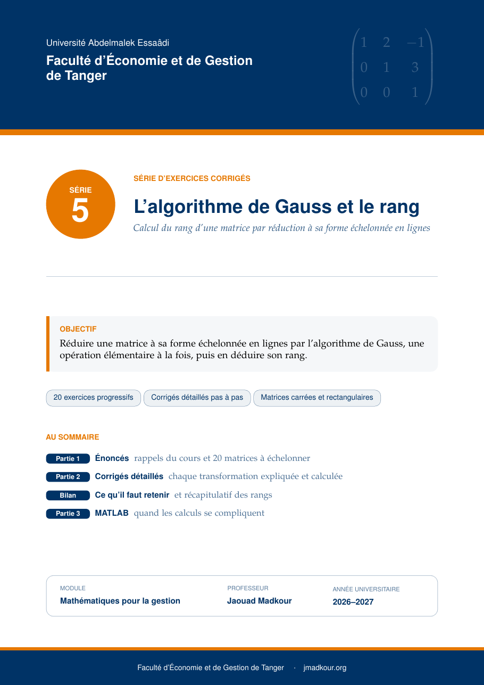

Série 5 d'exercices corrigés du cours [Mathématiques pour la gestion](../index.qmd) :
20 matrices à échelonner par l'algorithme de Gauss pour calculer leur rang, avec des corrigés détaillés pas à pas.

::: {.text-center}
[{width=360px fig-alt="Page de garde de la série d'exercices n°5 : L'algorithme de Gauss et le rang"}](algorithme-gauss-rang.pdf)

[Télécharger le PDF](algorithme-gauss-rang.pdf){.btn .btn-primary .btn-lg}
:::
