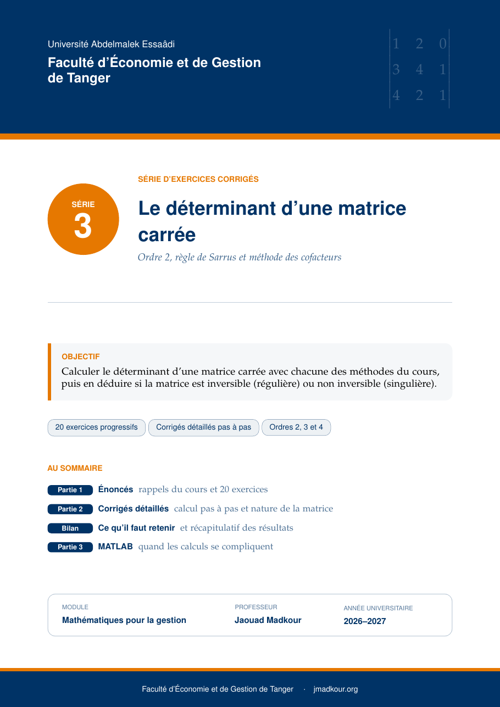

Série 3 d'exercices corrigés du cours [Mathématiques pour la gestion](../index.qmd) :
21 exercices progressifs sur la trace et le déterminant d'une matrice carrée (ordre 2, règle de Sarrus, méthode des cofacteurs), pour savoir si une matrice est inversible ou singulière.

::: {.text-center}
[{width=360px fig-alt="Page de garde de la série d'exercices n°3 : La trace et le déterminant"}](determinant.pdf)

[Télécharger le PDF](determinant.pdf){.btn .btn-primary .btn-lg}
:::
