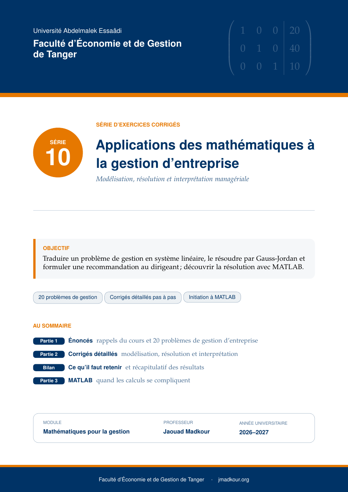

Série 9 d'exercices corrigés du cours [Mathématiques pour la gestion](../index.qmd) :
20 problèmes de gestion d'entreprise (production, comptabilité de gestion, finance, marketing, logistique, ressources humaines) traduits en systèmes linéaires, résolus par Gauss-Jordan et interprétés, avec une initiation à MATLAB.

::: {.text-center}
[{width=360px fig-alt="Page de garde de la série d'exercices n°9 : Applications des mathématiques à la gestion d'entreprise"}](gauss-jordan-gestion.pdf)

[Télécharger le PDF](gauss-jordan-gestion.pdf){.btn .btn-primary .btn-lg}
:::
