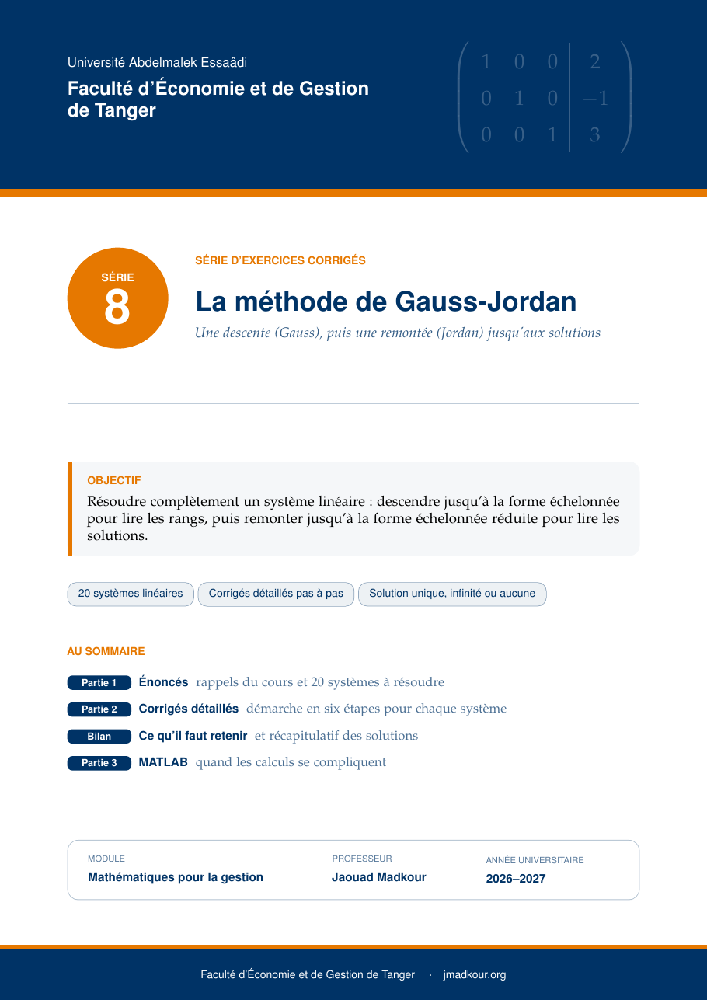

Série 8 d'exercices corrigés du cours [Mathématiques pour la gestion](../index.qmd) :
20 systèmes linéaires résolus par la méthode de Gauss-Jordan, une descente (Gauss) puis une remontée (Jordan), avec des corrigés détaillés pas à pas et une vérification de chaque solution.

::: {.text-center}
[{width=360px fig-alt="Page de garde de la série d'exercices n°8 : La méthode de Gauss-Jordan"}](gauss-jordan.pdf)

[Télécharger le PDF](gauss-jordan.pdf){.btn .btn-primary .btn-lg}
:::
