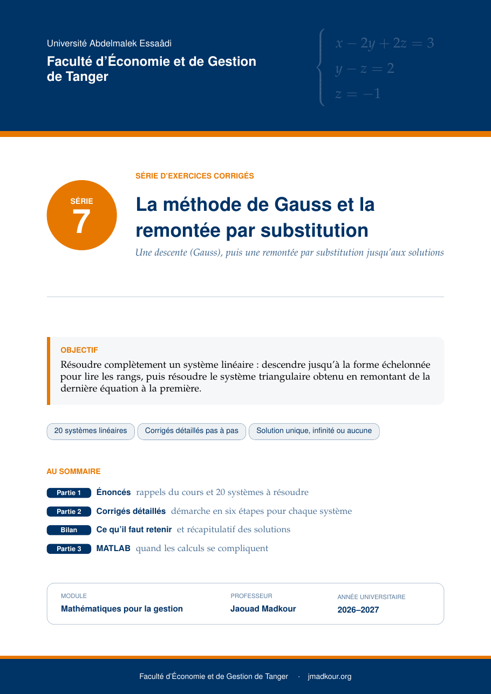

Série 7 d'exercices corrigés du cours [Mathématiques pour la gestion](../index.qmd) :
20 systèmes linéaires résolus par la méthode de Gauss : une descente jusqu'à la forme échelonnée, puis une remontée par substitution, avec des corrigés détaillés pas à pas et une vérification de chaque solution.

::: {.text-center}
[{width=360px fig-alt="Page de garde de la série d'exercices n°7 : La méthode de Gauss et la remontée par substitution"}](gauss-substitution.pdf)

[Télécharger le PDF](gauss-substitution.pdf){.btn .btn-primary .btn-lg}
:::
