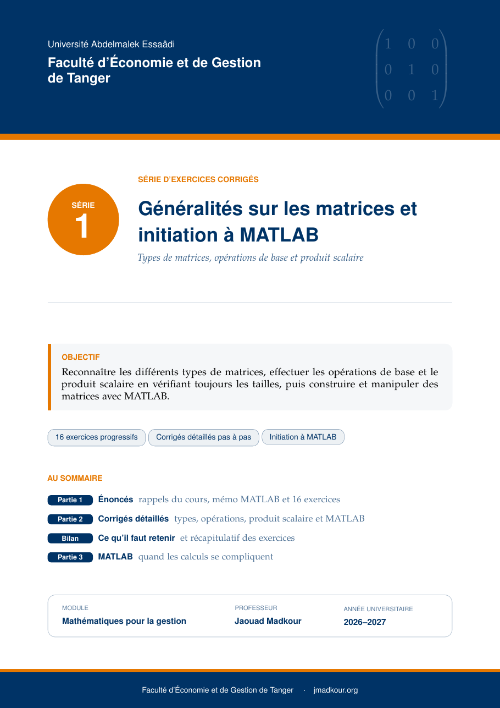

Série 1 d'exercices corrigés du cours [Mathématiques pour la gestion](../index.qmd) :
16 exercices progressifs sur les types de matrices, les opérations de base (somme, produit par un nombre, transposée) et le produit scalaire, avec une initiation à MATLAB.

::: {.text-center}
[{width=360px fig-alt="Page de garde de la série d'exercices n°1 : Généralités sur les matrices et initiation à MATLAB"}](generalites-matrices.pdf)

[Télécharger le PDF](generalites-matrices.pdf){.btn .btn-primary .btn-lg}
:::
