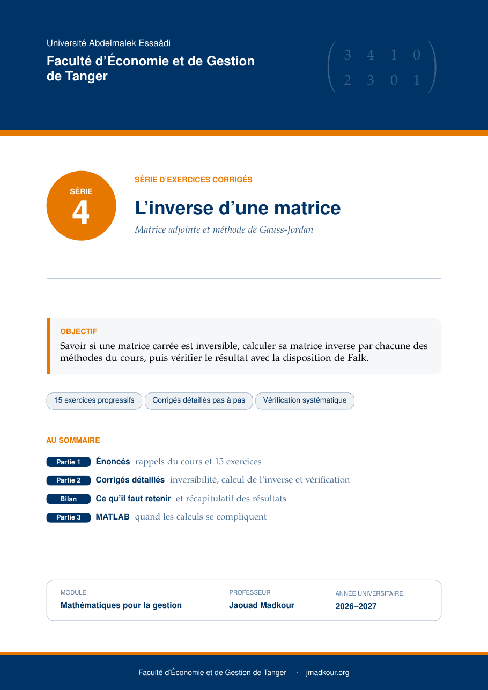

Série 4 d'exercices corrigés du cours [Mathématiques pour la gestion](../index.qmd) :
15 exercices progressifs pour savoir si une matrice est inversible, calculer son inverse par la matrice adjointe ou par Gauss-Jordan, puis vérifier le résultat par un produit matriciel.

::: {.text-center}
[{width=360px fig-alt="Page de garde de la série d'exercices n°4 : L'inverse d'une matrice"}](inverse-matrice.pdf)

[Télécharger le PDF gratuit](inverse-matrice.pdf){.btn .btn-primary .btn-lg}
:::
