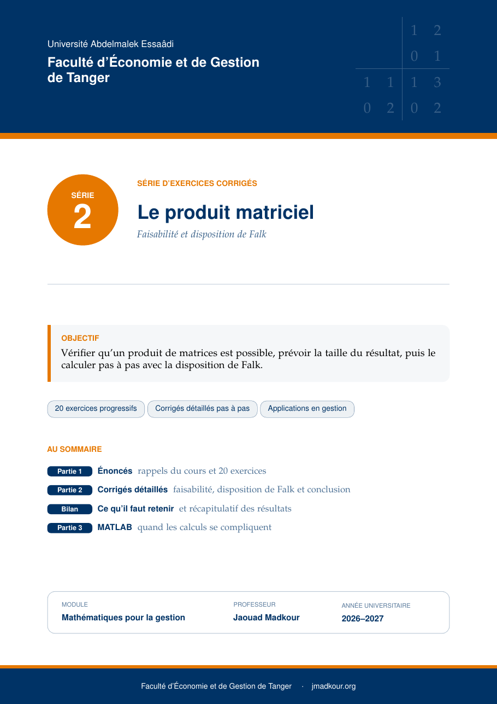

Série 2 d'exercices corrigés du cours [Mathématiques pour la gestion](../index.qmd) :
20 exercices progressifs sur le produit matriciel. Pour chaque produit, on vérifie d'abord qu'il est possible, puis on le calcule pas à pas avec la disposition de Falk.

::: {.text-center}
[{width=360px fig-alt="Page de garde de la série d'exercices n°2 : Le produit matriciel"}](produit-matriciel.pdf)

[Télécharger le PDF gratuit](produit-matriciel.pdf){.btn .btn-primary .btn-lg}
:::
