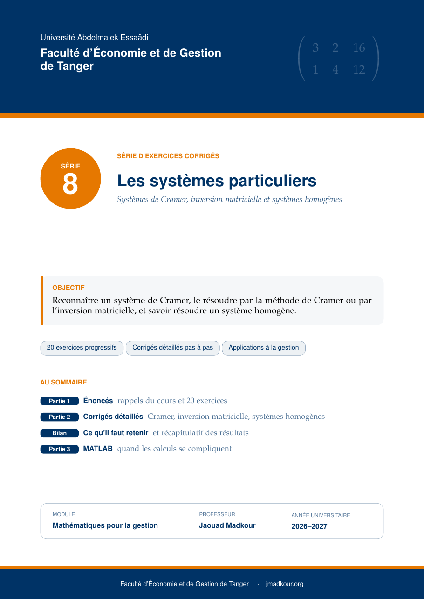

Série 8 d'exercices corrigés du cours [Mathématiques pour la gestion](../index.qmd) :
20 exercices progressifs sur les systèmes particuliers : reconnaître un système de Cramer, le résoudre par la méthode de Cramer ou par l'inversion matricielle, et résoudre un système homogène.

::: {.text-center}
[{width=360px fig-alt="Page de garde de la série d'exercices n°8 : Les systèmes particuliers"}](systemes-particuliers.pdf)

[Télécharger le PDF gratuit](systemes-particuliers.pdf){.btn .btn-primary .btn-lg}
:::
